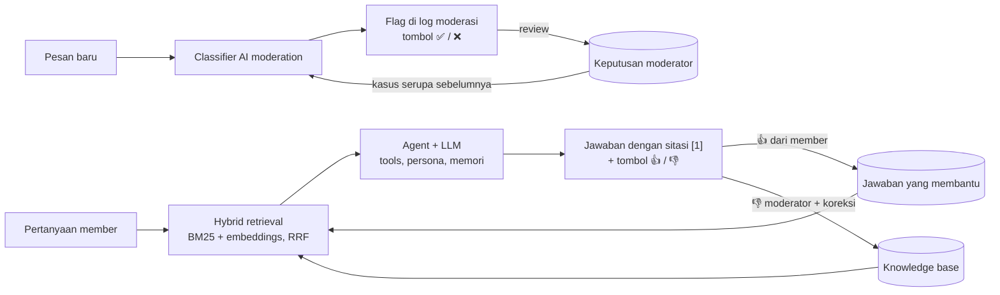
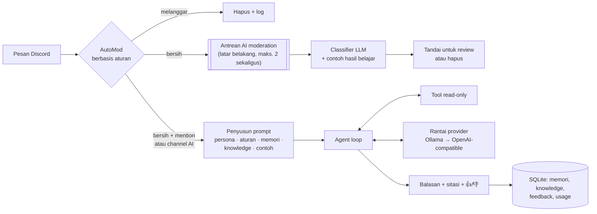

# Carl Lite: bot moderasi Discord yang terus belajar

[English](README.md) · **Bahasa Indonesia**

Bot moderasi Discord dengan **agent LLM** bawaan. Bot ini menjawab pertanyaan dari **knowledge base milik server sendiri (RAG hybrid dengan sitasi)**. Bot juga **terus belajar** dari feedback member, koreksi moderator, dan review moderasi, tanpa melatih ulang modelnya. Sebuah **eval harness** mengukur apakah pembelajaran itu benar-benar membantu.

Bot berjalan di **model lokal (Ollama)** atau **API apa pun yang kompatibel dengan OpenAI**, dan otomatis pindah ke yang lain kalau salah satunya bermasalah.


<!-- Tip: tambahkan screenshot atau GIF singkat di sini, misalnya jawaban dengan sitasi 📚 dan tombol 👍/👎, serta flag AI moderation dengan tombol review. -->

> **Mau review kodenya?** Mulai dari [tur kode](#tur-kode-mulai-baca-dari-mana). Isinya sepuluh file yang paling layak dibaca, ditambah alur satu pesan dari awal sampai akhir. Kode AI diberi komentar langkah demi langkah (dalam bahasa Inggris).

## Fitur unggulan

| | |
|---|---|
| 📚 **RAG hybrid dengan sitasi** | Admin mengunggah aturan, FAQ, dan panduan. Retrieval menggabungkan **pencarian kata kunci BM25 (SQLite FTS5)** dengan **kemiripan embedding**, lalu menyatukan hasilnya dengan **Reciprocal Rank Fusion**. Jawaban menyebut sumbernya (`[1]`), dan footnote menampilkan dokumennya. Tanpa model embedding, bot otomatis memakai pencarian kata kunci saja. |
| 🔁 **Continuous learning tanpa retraining** | **👍** menandai jawaban sebagai membantu, lalu jawaban itu dipakai sebagai contoh few-shot untuk pertanyaan serupa. **👎 dari moderator** membuka form, dan jawaban hasil koreksi langsung masuk ke knowledge base. **Flag AI moderation** punya tombol review ✅/❌, dan keputusan moderator menjadi contoh yang menyesuaikan classifier dengan norma server sendiri. |
| 🧪 **Eval harness** | `npm run eval` mengukur tiga hal pada dataset berlabel Indonesia/Inggris: AI moderation (precision/recall/F1, zero-shot vs. few-shot hasil belajar), retrieval (Hit@k dan MRR untuk keyword vs. vector vs. hybrid), dan jawaban berbasis sumber (akurasi fakta, tingkat sitasi). Hasilnya disimpan sebagai Markdown + JSON. |
| 🧠 **Agent dengan tool calling** | Asisten bisa memanggil tool read-only dalam sebuah loop dengan batas langkah. Tool-nya: jam, info server, cari member, pesan terbaru, pencarian knowledge base, dan riwayat warning (khusus moderator). Akses tool mengikuti permission Discord. |
| 🔌 **Tidak terikat satu provider LLM** | Mendukung Ollama dan semua API yang kompatibel dengan OpenAI. Dilengkapi **rantai fallback dengan circuit breaker**, retry dengan exponential backoff yang menghormati `Retry-After`, structured output (JSON schema), vision, dan health check. |
| 🛡️ **AI moderation dengan pengawasan manusia** | Pesan yang lolos filter berbasis aturan diklasifikasi dengan output JSON schema. Secara default bot hanya menandai pesan untuk direview. Kalau terjadi error, bot **tidak mengambil tindakan apa pun** (fail open), dan tidak pernah menghapus otomatis postingan yang mungkin berkaitan dengan self-harm. |
| 👤 **Memori personal yang dikendalikan user** | Chat panjang diringkas menjadi rolling summary, dan fakta penting tentang tiap member diekstrak (misalnya "lebih suka bahasa Inggris"). Member bisa melihat dan menghapus semuanya lewat `/ai memory`. |
| 📊 **Observability** | `/ai learning` menampilkan apa yang sudah dipelajari bot: tingkat kepuasan, presisi moderation dari hasil review, dan jumlah koreksi. `/ai status` menampilkan kesehatan model, token, dan latensi. |
| 🔨 **Moderasi klasik** | Timeout, kick, ban, purge, dan warning. AutoMod mencakup link, kata terlarang (dicocokkan per kata utuh), huruf kapital berlebihan, dan spam. Ada juga pesan sambutan, log, dan reaction role. |

## Cara bot belajar



Bobot model tidak pernah berubah. Fine-tuning langsung dari chat Discord akan lambat, mahal, dan gampang disabotase dengan data yang sengaja disesatkan. Sebagai gantinya, bot memperbaiki **konteks** yang diberikan ke model lewat beberapa learning loop berbasis retrieval:

| Sinyal | Siapa yang bisa memberi | Apa yang dilakukan bot |
|---|---|---|
| 👍 pada jawaban | siapa saja | Untuk pertanyaan serupa berikutnya, jawaban itu dipakai sebagai contoh referensi (few-shot). 👎 dari moderator membatalkannya. |
| 👎 + koreksi | moderator | Koreksi disimpan di knowledge base, ditemukan lagi lewat retrieval, dan dikutip sebagai sumber. |
| ✅ / ❌ pada flag AI moderation | moderator | Keputusan disimpan. Pesan serupa berikutnya diklasifikasi dengan keputusan itu sebagai contoh few-shot tentang norma **server ini** (misalnya "trash talk boleh, jual akun tidak"). |
| Percakapan panjang | otomatis | Bot menyimpan rolling summary dan maksimal 20 fakta per member (`/ai memory view · remember · forget`). |

Hanya role tepercaya yang bisa mengubah apa yang dianggap fakta oleh bot, jadi member biasa tidak bisa menyusupkan informasi palsu ke knowledge base.

## Mengukurnya: eval

```bash
npm run eval -- rag --retrieval-only                               # tidak butuh model
npm run eval -- rag --embed ollama:bge-m3 --models ollama:qwen3:4b
npm run eval -- moderation --models ollama:qwen3:4b,openai:gpt-5-mini
```

| Suite | Dataset | Metrik |
|---|---|---|
| Moderation | 45 pesan berlabel (Indonesia/Inggris), 8 di antaranya bergantung pada norma server, ditambah 12 simulasi keputusan moderator | accuracy, precision, recall, F1, akurasi norma server, akurasi kategori, latensi, token, **zero-shot vs. few-shot (hasil belajar)** |
| Retrieval | 4 dokumen knowledge, 16 pertanyaan (sebagian sengaja diparafrasekan) | Hit@1, Hit@3, dan MRR untuk keyword vs. vector vs. hybrid |
| Jawaban berbasis sumber | pertanyaan yang sama, masing-masing dengan fakta wajib | akurasi jawaban, tingkat sitasi, latensi |

Baseline keyword tidak butuh model dan sudah diukur pada dataset ini:

| Retrieval | Hit@1 | Hit@3 | MRR |
|---|---|---|---|
| keyword (BM25) | 75,0% | 81,3% | 0,781 |

Pertanyaan yang gagal adalah yang diparafrasekan, misalnya *"Jam berapa kita main bareng di dunia kotak-kotak tiap hari Minggu?"*, yang sama sekali tidak menyebut "Minecraft". Celah inilah yang mestinya ditutup oleh semantic embeddings. Jalankan perintah di atas dengan model sendiri untuk mengisi hasil vector/hybrid, moderation, dan jawaban. Laporannya disimpan di `evals/results/`.

## Alur pesan



System prompt disusun berlapis: persona → konteks server → instruksi admin → memori personal → ringkasan percakapan → kutipan knowledge → contoh yang dinilai bagus → aturan pemakaian tool → guardrail yang tidak bisa ditimpa oleh file persona. Catatan singkat "siapa yang sedang bicara / mode yang aktif" diletakkan tepat sebelum pesan user, supaya model lokal yang kecil tidak kehilangan informasi itu.

## Tur kode: mulai baca dari mana

Kode AI diberi komentar langkah demi langkah (`// 1.`, `// 2.`, …) dalam bahasa Inggris, lengkap dengan alasan di balik setiap keputusan. Kalau hanya punya sepuluh menit, baca file-file ini secara berurutan:

| # | File | Isinya |
|---|---|---|
| 1 | [`src/ai/chat.ts`](src/ai/chat.ts) | **Mulai di sini.** `generateChatReply` menyusun satu jawaban dari awal sampai akhir: memori → retrieval (`gatherKnowledge`) → prompt → agent → sitasi → pencatatan usage. |
| 2 | [`src/ai/agent.ts`](src/ai/agent.ts) | `runAgent`: loop tool calling dengan batas langkah dan timeout per tool. Error dari tool dikembalikan ke model sebagai data. |
| 3 | [`src/ai/rag/knowledge.ts`](src/ai/rag/knowledge.ts) | `retrieveKnowledge`: BM25 (SQLite FTS5) plus cosine similarity, digabung dengan Reciprocal Rank Fusion. |
| 4 | [`src/ai/rag/text.ts`](src/ai/rag/text.ts) | `chunkText`: memecah dokumen mengikuti paragraf dan kalimat, dengan overlap. Juga menyusun query FTS yang kebal injeksi. |
| 5 | [`src/ai/learning/exchanges.ts`](src/ai/learning/exchanges.ts) | `HELPFUL_EXCHANGES` dan `findExemplars`: feedback 👍 menjadi contoh few-shot, dan 👎 dari moderator berlaku sebagai veto. |
| 6 | [`src/features/learning-interactions.ts`](src/features/learning-interactions.ts) | Tombol dan form: vote; koreksi moderator masuk ke knowledge base; review ✅/❌ menjadi contoh moderation. |
| 7 | [`src/features/ai-moderation.ts`](src/features/ai-moderation.ts) → [`src/ai/moderation.ts`](src/ai/moderation.ts) | Moderasi di latar belakang: contoh hasil belajar, structured output, pembatas pesan untuk mencegah prompt injection, dan parsing yang tidak mengambil tindakan apa pun kalau output model tidak terbaca. |
| 8 | [`src/ai/providers/`](src/ai/providers/) | `fallback.ts` (circuit breaker), `http.ts` (timeout, retry dengan jitter), `openai-compatible.ts` (kekhasan model reasoning), `ollama.ts` (model tanpa dukungan tool). |
| 9 | [`src/ai/persona.ts`](src/ai/persona.ts) | `buildSystemPrompt`: system prompt berlapis, ditutup dengan guardrail yang tidak bisa ditimpa persona. |
| 10 | [`src/evals/moderation-eval.ts`](src/evals/moderation-eval.ts) | Cara pembelajaran diukur: model yang sama, zero-shot vs. dengan contoh hasil belajar. |

### Ikuti satu pesan di dalam kode

1. **Event:** [`src/bot.ts`](src/bot.ts) menjalankan AutoMod lebih dulu ([`features/automod.ts`](src/features/automod.ts) › `runAutomod`). Pesan yang bersih masuk ke antrean AI moderation ([`features/ai-moderation.ts`](src/features/ai-moderation.ts) › `scheduleAiModeration`).
2. **Perlu dijawab?** [`ai/chat-handler.ts`](src/ai/chat-handler.ts) › `handleAiMessage` memeriksa channel AI atau mention, panjang pesan, cooldown, dan apakah model sudah dikonfigurasi.
3. **Konteks:** [`ai/chat.ts`](src/ai/chat.ts) › `gatherKnowledge` meng-embed pertanyaan satu kali. Setelah itu fungsi ini mengambil knowledge ([`rag/knowledge.ts`](src/ai/rag/knowledge.ts)), jawaban yang dinilai bagus ([`learning/exchanges.ts`](src/ai/learning/exchanges.ts)), dan fakta tentang member ([`user-memory.ts`](src/ai/user-memory.ts)).
4. **Prompt:** [`ai/persona.ts`](src/ai/persona.ts) › `buildSystemPrompt` + `buildTurnContext`.
5. **Agent:** [`ai/agent.ts`](src/ai/agent.ts) › `runAgent` berkomunikasi dengan rantai provider ([`providers/`](src/ai/providers/)) dan memanggil tool ([`ai/tools.ts`](src/ai/tools.ts)).
6. **Balasan:** [`rag/citations.ts`](src/ai/rag/citations.ts) mengubah `[1]` menjadi nama sumber. Tombol 👍/👎 dibuat oleh [`learning/components.ts`](src/ai/learning/components.ts).
7. **Belajar:** klik tombol diproses di [`features/learning-interactions.ts`](src/features/learning-interactions.ts). Indexer di latar belakang ([`rag/indexer.ts`](src/ai/rag/indexer.ts)) meng-embed contoh baru, supaya pertanyaan serupa berikutnya bisa menemukannya.

## Struktur proyek

```text
src/
├── ai/
│   ├── providers/        # Ollama, OpenAI-compatible, rantai fallback, HTTP + retry
│   ├── rag/              # chunking, hybrid search FTS5 + vector, RRF, sitasi, indexer embedding
│   ├── learning/         # feedback, review moderation, tombol/modal, statistik learning
│   ├── agent.ts          # loop tool calling
│   ├── tools.ts          # tool Discord read-only, disaring berdasarkan permission
│   ├── chat.ts           # retrieval + penyusunan prompt → agent → pencatatan usage
│   ├── embeddings.ts     # embedding Ollama / OpenAI, berhenti sementara kalau gagal
│   ├── moderation.ts     # classifier dengan contoh few-shot hasil belajar
│   ├── memory*.ts        # riwayat chat, rolling summary, ekstraksi fakta
│   └── user-memory.ts    # fakta per member
├── evals/                # runner eval, metrik, laporan, CLI
├── commands/             # /setup, /moderate, /reaction-role, /ai
├── features/             # automod, AI moderation, interaksi learning, log, sambutan
├── db/                   # SQLite + migrasi berversi (v1 → v3)
└── index.ts              # bootstrap, background job, shutdown yang rapi
evals/datasets/           # dataset moderation berlabel, contoh hasil belajar, dokumen knowledge, pertanyaan RAG
test/                     # 116 test, termasuk server tiruan Ollama / OpenAI
```

## Mulai cepat

**Kebutuhan:** Node.js 20.6+ (disarankan 22 atau 24), plus [Ollama](https://ollama.com/download) atau API key dari provider yang kompatibel dengan OpenAI.

1. **Buat aplikasi Discord** di [Developer Portal](https://discord.com/developers/applications). Aktifkan intent **Server Members** dan **Message Content**. Undang bot dengan scope `bot` dan `applications.commands`, serta permission berikut: View Channels, Send Messages, Embed Links, Read Message History, Manage Messages, Moderate Members, Kick Members, Ban Members, Manage Roles, dan Add Reactions.
2. **Konfigurasi dan jalankan:**

   ```bash
   cp .env.example .env   # isi DISCORD_TOKEN, CLIENT_ID, dan provider AI
   npm install
   npm run register       # kalau GUILD_ID diisi, command langsung diperbarui di server itu
   npm run dev
   ```

3. **Di Discord** (sebagai administrator):

   ```text
   /setup logs channel:#mod-logs
   /setup automod anti_spam:true ai_moderation:true ai_action:flag
   /ai setup channel:#ai-chat
   /ai knowledge upload file:rules.md
   /ai learning
   ```

### Memilih model

| Setup | `.env` |
|---|---|
| Lokal saja (gratis, privat) | `AI_PROVIDER=ollama` · `OLLAMA_MODEL=qwen3:4b` · `OLLAMA_EMBED_MODEL=bge-m3` |
| Cloud saja | `AI_PROVIDER=openai` · `OPENAI_MODEL=gpt-5-mini` · `OPENAI_EMBED_MODEL=text-embedding-3-small` |
| Lokal dulu, cloud sebagai cadangan | `AI_PROVIDER=ollama` · `AI_FALLBACK_PROVIDER=openai` |
| API lain yang kompatibel dengan OpenAI | `AI_PROVIDER=openai` · `OPENAI_BASE_URL=https://openrouter.ai/api/v1` (atau Groq, LM Studio, …) |

**Tool** butuh model yang mendukung tool calling (`qwen3`, `llama3.1`, `gpt-5-mini`). Model tanpa dukungan tool, seperti `gemma3`, terdeteksi otomatis, dan RAG tetap berjalan lewat retrieval otomatis. **Vision** butuh model multimodal. Kalau model embedding diganti, semua data otomatis di-embed ulang di latar belakang.

## Command

| Command | Siapa | Fungsinya |
|---|---|---|
| `/ai ask prompt [private]` | semua | Bertanya ke asisten (memori, tool, dan knowledge-nya sama seperti lewat mention) |
| `/ai summarize [messages] [public]` | semua | Ringkasan (TL;DR) percakapan terbaru di channel |
| `/ai memory view · remember · forget` | semua | Melihat, menambah, atau menghapus apa yang diingat bot tentang diri sendiri |
| `/ai reset [scope] [user] [confirm]` | semua / admin | Menghapus memori percakapan (milik sendiri, atau milik user/channel/server) |
| `/ai knowledge add · upload · list · remove · search` | admin | Mengelola knowledge base; `search` menunjukkan persis apa yang ditemukan retrieval |
| `/ai learning` | admin | Feedback, koreksi, presisi moderation, memori personal |
| `/ai setup · instructions · status · disable` | admin | Channel, instruksi server, kesehatan model, dan pemakaian |
| `/setup welcome · logs · automod · status` | Manage Server | Sambutan, log, AutoMod berbasis aturan dan AI |
| `/moderate timeout · kick · ban · purge · warn · warnings` | moderator | Aksi moderasi, disertai DM ke member dan entri log |
| `/reaction-role add · remove` | Manage Roles | Pasangan emoji → role |

Jawaban dilengkapi footnote seperti `🔧 recent messages  |  📚 [1] Server Rules`, plus tombol 👍/👎 yang jumlah vote-nya langsung diperbarui.

## Konfigurasi

Semua pengaturan berupa environment variable, dan [`.env.example`](.env.example) menjelaskan semuanya. Yang paling penting:

| Variabel | Default | Fungsi |
|---|---|---|
| `AI_PROVIDER` / `AI_FALLBACK_PROVIDER` | otomatis / – | `ollama`, `openai`, atau `none` |
| `OLLAMA_MODEL`, `OLLAMA_NUM_CTX` | –, `8192` | Model chat lokal dan context window-nya |
| `OPENAI_BASE_URL`, `OPENAI_API_KEY`, `OPENAI_MODEL` | OpenAI | API apa pun yang kompatibel dengan OpenAI |
| `OLLAMA_EMBED_MODEL` / `OPENAI_EMBED_MODEL` | – | Embedding untuk pencarian semantik (opsional) |
| `AI_RAG_MIN_SIMILARITY` | `0.45` | Cosine similarity minimum untuk kecocokan semantik |
| `AI_LEARNING` | `true` | Tombol feedback, koreksi, review, ekstraksi fakta |
| `AI_TOOLS` / `AI_VISION` | `true` / `true` | Saklar fitur |
| `AI_PERSONA_FILE` | bawaan | File JSON persona (kepribadian, mode, member yang dikenal) |

Persona berupa file JSON yang berisi instruksi, **mode** yang aktif karena kata kunci tertentu, dan **member yang dikenal**. Lihat [`personas/shy-gamer.example.json`](personas/shy-gamer.example.json). File bernama `*.local.json` tidak ikut ke Git.

## Keamanan dan privasi sejak desain

- **Pembelajaran tidak bisa disabotase member.** Hanya moderator yang bisa mengajarkan fakta atau me-review flag, dan 👎 dari moderator membatalkan sebuah contoh.
- **Tidak ada ping yang tidak diinginkan.** Balasan hanya bisa nge-ping penanya, orang yang dia mention, dan member yang dikenal. Role, `@everyone`, dan `@here` tidak pernah ter-ping.
- **Tool read-only dengan hak akses minimum.** Riwayat warning hanya tersedia untuk moderator. Pesan terbaru hanya bisa dibaca kalau penanya dan bot sama-sama punya akses ke channel tersebut.
- **Perlindungan dari prompt injection.** Nama user dibersihkan. Kutipan knowledge, hasil tool, transkrip, dan pesan yang dimoderasi diberi pembatas dan ditandai sebagai data, bukan instruksi. Query FTS diberi tanda kutip supaya operator tidak bisa disisipkan.
- **Moderasi yang hati-hati.** Kalau terjadi error, tidak ada tindakan yang diambil. Default-nya hanya menandai pesan untuk direview manusia, memakai ambang confidence, dan tidak pernah menghapus otomatis postingan yang mungkin berkaitan dengan self-harm.
- **Data dibatasi.** Memori chat dan jawaban tanpa rating kedaluwarsa setelah 30 hari. Contoh jawaban yang membantu disimpan maksimal 180 hari. Flag yang belum direview kedaluwarsa setelah 30 hari, dan yang sudah direview dibatasi 500 per server. Ekstraksi fakta diinstruksikan untuk melewati kategori sensitif (kesehatan, agama, politik, alamat…), dan member bisa melihat serta menghapus semuanya lewat `/ai memory`.
- **Log yang bersih.** Log hanya berisi ID, kode, dan durasi, tidak pernah isi pesan atau data rahasia.

## Testing

```bash
npm run check   # type-check ketat + 116 test, tanpa Discord atau model
```

- **Server HTTP tiruan** meniru API Ollama dan OpenAI untuk chat dan embedding: pemetaan request, tool call, retry, timeout, error kuota, dan health check.
- **Test end-to-end** menjalankan seluruh pipeline chat, termasuk skenario "model lokal tidak ada → fallback ke cloud" dan jawaban RAG dengan sitasi.
- **Test retrieval** berjalan pada dokumen eval yang sebenarnya. Embedder tiruan yang deterministik menunjukkan hybrid search berhasil menemukan pertanyaan parafrase yang terlewat oleh BM25.
- **Test learning** mencakup jumlah feedback, veto moderator, keputusan review → contoh few-shot, ekstraksi fakta, dan masa simpan data.
- **Test eval** memeriksa metrik dan sebuah classifier tiruan yang akurasi norma servernya naik dari 0% ke 100% setelah belajar dari keputusan moderator.
- **SQLite in-memory** dipakai untuk menguji migrasi v1 → v3 pada database yang dibuat oleh versi aslinya.

GitHub Actions menjalankan type-check, test, dan build di Node 22 dan 24.

## Deployment

```bash
docker compose up -d --build
```

Volume `data/` menyimpan pengaturan, memori, knowledge base, dan data learning, jadi semuanya tetap ada saat container di-restart. Kalau Ollama berjalan di host, isi `OLLAMA_BASE_URL=http://host.docker.internal:11434`. Jangan pernah membuka port Ollama ke internet, karena port itu tidak memakai autentikasi. SQLite cocok untuk satu proses bot. Untuk sharding, pindahkan `db/` ke PostgreSQL dan vector-nya ke pgvector.
