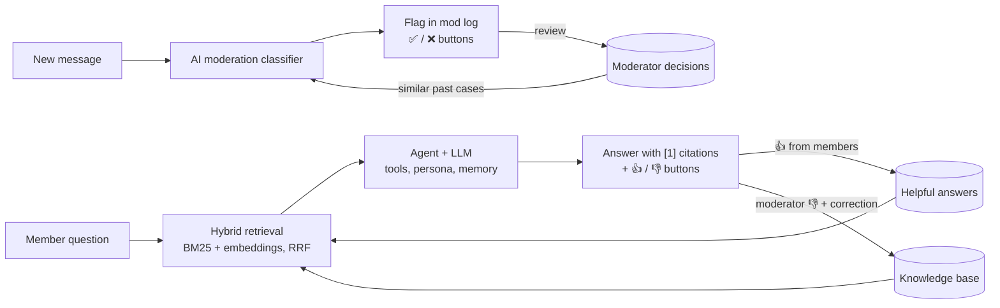
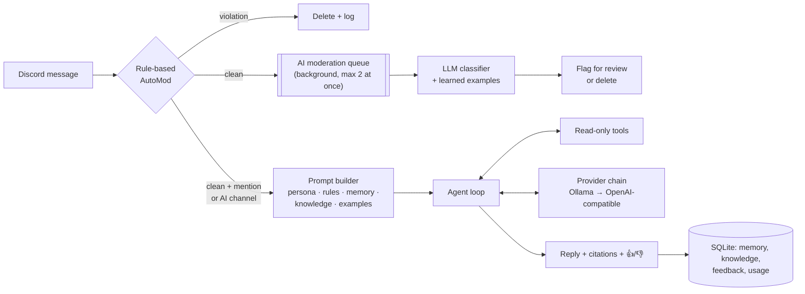

# Carl Lite: a Discord moderation bot that learns

**English** · [Bahasa Indonesia](README.id.md)

A Discord moderation bot with a built-in **LLM agent**. It answers questions from the server's own **knowledge base (hybrid RAG with citations)**. It **learns continuously** from member feedback, moderator corrections and moderation reviews, without retraining the model. An **eval harness** measures whether that learning actually helps.

It runs on a **local model (Ollama)** or **any OpenAI-compatible API**, and falls back from one to the other automatically.


<!-- Tip: add a screenshot or short GIF here, e.g. an answer with 📚 citations and 👍/👎 buttons, and an AI moderation flag with review buttons. -->

> **Reviewing the code?** Start with the [code tour](#code-tour-where-to-look). It lists the ten files worth reading and follows one message through the code. The AI code is commented step by step.

## Highlights

| | |
|---|---|
| 📚 **Hybrid RAG with citations** | Admins upload rules, FAQs and guides. Retrieval combines **BM25 keyword search (SQLite FTS5)** with **embedding similarity**, merged with **Reciprocal Rank Fusion**. Answers cite their sources (`[1]`), and a footnote lists the documents. Without an embedding model the bot falls back to keyword search. |
| 🔁 **Continuous learning, no retraining** | **👍** marks an answer as helpful, and it becomes a few-shot example for similar questions. A **moderator's 👎** opens a form, and the corrected answer goes straight into the knowledge base. **AI moderation flags** have ✅/❌ review buttons, and those decisions become examples that adapt the classifier to the server's own norms. |
| 🧪 **Eval harness** | `npm run eval` scores AI moderation (precision/recall/F1, zero-shot vs. learned few-shot), retrieval (Hit@k, MRR for keyword vs. vector vs. hybrid) and grounded answers (fact accuracy, citation rate) on labelled Indonesian/English datasets. Results are written as Markdown + JSON. |
| 🧠 **Tool-calling agent** | The assistant can call read-only tools in a loop with a step budget: time, server info, member lookup, recent messages, knowledge search and, for moderators only, warnings. Tool access follows Discord permissions. |
| 🔌 **Provider-agnostic LLM layer** | Covers Ollama and every OpenAI-compatible API. Includes a **fallback chain with a circuit breaker**, retries with exponential backoff that honour `Retry-After`, structured output (JSON schema), vision, and health checks. |
| 🛡️ **AI moderation with a human in the loop** | Messages that pass the rule-based filters are classified with JSON-schema output. The bot flags for review by default, **fails open** on errors and never auto-deletes possible self-harm posts. |
| 👤 **Personal memory that users control** | Long chats are compressed into rolling summaries, and durable facts about each member are extracted ("prefers English"). Members can see and delete everything with `/ai memory`. |
| 📊 **Observability** | `/ai learning` shows what the bot has learned (satisfaction rate, moderation precision from reviews, corrections). `/ai status` shows model health, tokens and latency. |
| 🔨 **Classic moderation** | Timeout, kick, ban, purge and warnings. AutoMod covers links, whole-word blocked words, caps and spam. Also welcome messages, logs and reaction roles. |

## How it learns



The model's weights never change. Online fine-tuning on Discord chats would be slow, expensive and easy to poison. Instead, the bot improves its **context**, using several retrieval-based learning loops:

| Signal | Who can give it | What the bot does with it |
|---|---|---|
| 👍 on an answer | anyone | Similar future questions get the answer as a reference example (few-shot). A moderator's 👎 vetoes it. |
| 👎 + correction | moderators | The correction is stored in the knowledge base, retrieved next time and cited. |
| ✅ / ❌ on an AI moderation flag | moderators | The decision is stored. Similar future messages are classified with it as a few-shot example of **this server's** norms (e.g. "trash talk is fine here, selling accounts is not"). |
| Long conversations | automatic | The bot keeps a rolling summary plus up to 20 facts per member (`/ai memory view · remember · forget`). |

Only trusted roles can change what the bot treats as fact, so regular members cannot poison the knowledge base.

## Measuring it: evals

```bash
npm run eval -- rag --retrieval-only                               # no model needed
npm run eval -- rag --embed ollama:bge-m3 --models ollama:qwen3:4b
npm run eval -- moderation --models ollama:qwen3:4b,openai:gpt-5-mini
```

| Suite | Dataset | Metrics |
|---|---|---|
| Moderation | 45 labelled messages (Indonesian/English), 8 of them depend on server norms, plus 12 simulated moderator decisions | accuracy, precision, recall, F1, server-norm accuracy, category accuracy, latency, tokens, **zero-shot vs. few-shot (learned)** |
| Retrieval | 4 knowledge documents, 16 questions (some paraphrased on purpose) | Hit@1, Hit@3, MRR for keyword vs. vector vs. hybrid |
| Grounded answers | same questions with required facts | answer accuracy, citation rate, latency |

The keyword baseline needs no model and was measured on this dataset:

| Retrieval | Hit@1 | Hit@3 | MRR |
|---|---|---|---|
| keyword (BM25) | 75.0% | 81.3% | 0.781 |

The misses are the paraphrased questions, such as *"Jam berapa kita main bareng di dunia kotak-kotak tiap hari Minggu?"*, which never mentions "Minecraft". This is the gap semantic embeddings are meant to close. Run the commands above with your models to fill in the vector/hybrid, moderation and answer tables. Reports are saved in `evals/results/`.

## Message pipeline



The system prompt is built in layers: persona → server context → admin instructions → personal memory → conversation summary → knowledge excerpts → rated examples → tool policy → guardrails that a persona file cannot override. A short "who is speaking / active mode" note sits right before the user's message, so small local models keep track of it.

## Code tour: where to look

The AI code is commented step by step (`// 1.`, `// 2.`, …), with the *why* behind each decision. With ten minutes, read these files in this order:

| # | File | What it shows |
|---|---|---|
| 1 | [`src/ai/chat.ts`](src/ai/chat.ts) | **Start here.** `generateChatReply` builds one answer end to end: memory → retrieval (`gatherKnowledge`) → prompt → agent → citations → usage tracking. |
| 2 | [`src/ai/agent.ts`](src/ai/agent.ts) | `runAgent`: the tool-calling loop with a step budget and tool timeouts. Tool errors go back to the model as data. |
| 3 | [`src/ai/rag/knowledge.ts`](src/ai/rag/knowledge.ts) | `retrieveKnowledge`: BM25 (SQLite FTS5) plus cosine similarity, merged with Reciprocal Rank Fusion. |
| 4 | [`src/ai/rag/text.ts`](src/ai/rag/text.ts) | `chunkText`: chunking along paragraphs and sentences, with overlap. Also builds FTS queries that cannot be injected. |
| 5 | [`src/ai/learning/exchanges.ts`](src/ai/learning/exchanges.ts) | `HELPFUL_EXCHANGES` and `findExemplars`: 👍 feedback becomes few-shot examples, and a moderator's 👎 is a veto. |
| 6 | [`src/features/learning-interactions.ts`](src/features/learning-interactions.ts) | The buttons and the form: votes; moderator corrections go into the knowledge base; ✅/❌ reviews become moderation examples. |
| 7 | [`src/features/ai-moderation.ts`](src/features/ai-moderation.ts) → [`src/ai/moderation.ts`](src/ai/moderation.ts) | Background moderation: learned examples, structured output, message delimiting against prompt injection, and parsing that fails open. |
| 8 | [`src/ai/providers/`](src/ai/providers/) | `fallback.ts` (circuit breaker), `http.ts` (timeouts, retries with jitter), `openai-compatible.ts` (reasoning-model quirks), `ollama.ts` (models without tool support). |
| 9 | [`src/ai/persona.ts`](src/ai/persona.ts) | `buildSystemPrompt`: the layered system prompt, ending with guardrails a persona cannot override. |
| 10 | [`src/evals/moderation-eval.ts`](src/evals/moderation-eval.ts) | How learning is measured: the same model, zero-shot vs. with learned examples. |

### Follow one message through the code

1. **Event:** [`src/bot.ts`](src/bot.ts) runs AutoMod first ([`features/automod.ts`](src/features/automod.ts) › `runAutomod`). Clean messages are queued for AI moderation ([`features/ai-moderation.ts`](src/features/ai-moderation.ts) › `scheduleAiModeration`).
2. **Should the bot answer?** [`ai/chat-handler.ts`](src/ai/chat-handler.ts) › `handleAiMessage` checks the AI channel or mention, message length, cooldown and whether a model is configured.
3. **Context:** [`ai/chat.ts`](src/ai/chat.ts) › `gatherKnowledge` embeds the question once. It then retrieves knowledge ([`rag/knowledge.ts`](src/ai/rag/knowledge.ts)), rated answers ([`learning/exchanges.ts`](src/ai/learning/exchanges.ts)) and the member's facts ([`user-memory.ts`](src/ai/user-memory.ts)).
4. **Prompt:** [`ai/persona.ts`](src/ai/persona.ts) › `buildSystemPrompt` + `buildTurnContext`.
5. **Agent:** [`ai/agent.ts`](src/ai/agent.ts) › `runAgent` talks to the provider chain ([`providers/`](src/ai/providers/)) and calls tools ([`ai/tools.ts`](src/ai/tools.ts)).
6. **Reply:** [`rag/citations.ts`](src/ai/rag/citations.ts) turns `[1]` into a source. The 👍/👎 buttons come from [`learning/components.ts`](src/ai/learning/components.ts).
7. **Learning:** a click lands in [`features/learning-interactions.ts`](src/features/learning-interactions.ts). The background indexer ([`rag/indexer.ts`](src/ai/rag/indexer.ts)) embeds the new example so the next similar question finds it.

## Project structure

```text
src/
├── ai/
│   ├── providers/        # Ollama, OpenAI-compatible, fallback chain, HTTP + retry
│   ├── rag/              # chunking, FTS5 + vector hybrid search, RRF, citations, embedding indexer
│   ├── learning/         # feedback, moderation reviews, buttons/modals, learning stats
│   ├── agent.ts          # tool-calling loop
│   ├── tools.ts          # read-only Discord tools, gated by permissions
│   ├── chat.ts           # retrieval + prompt assembly → agent → usage tracking
│   ├── embeddings.ts     # Ollama / OpenAI embeddings with failure back-off
│   ├── moderation.ts     # classifier with few-shot learned examples
│   ├── memory*.ts        # history, rolling summaries, fact extraction
│   └── user-memory.ts    # per-member facts
├── evals/                # eval runners, metrics, report, CLI
├── commands/             # /setup, /moderate, /reaction-role, /ai
├── features/             # automod, AI moderation, learning interactions, logs, welcome
├── db/                   # SQLite + versioned migrations (v1 → v3)
└── index.ts              # bootstrap, background jobs, graceful shutdown
evals/datasets/           # labelled moderation set, learned examples, knowledge docs, RAG questions
test/                     # 116 tests, including mock Ollama / OpenAI servers
```

## Quick start

**Requirements:** Node.js 20.6+ (22 or 24 recommended), plus either [Ollama](https://ollama.com/download) or an API key for an OpenAI-compatible provider.

1. **Create the Discord application** in the [Developer Portal](https://discord.com/developers/applications). Enable the **Server Members** and **Message Content** intents. Invite the bot with the `bot` and `applications.commands` scopes and these permissions: View Channels, Send Messages, Embed Links, Read Message History, Manage Messages, Moderate Members, Kick Members, Ban Members, Manage Roles and Add Reactions.
2. **Configure and run:**

   ```bash
   cp .env.example .env   # fill in DISCORD_TOKEN, CLIENT_ID and an AI provider
   npm install
   npm run register       # with GUILD_ID set, commands update instantly in that server
   npm run dev
   ```

3. **In Discord** (as an administrator):

   ```text
   /setup logs channel:#mod-logs
   /setup automod anti_spam:true ai_moderation:true ai_action:flag
   /ai setup channel:#ai-chat
   /ai knowledge upload file:rules.md
   /ai learning
   ```

### Choosing models

| Setup | `.env` |
|---|---|
| Local only (free, private) | `AI_PROVIDER=ollama` · `OLLAMA_MODEL=qwen3:4b` · `OLLAMA_EMBED_MODEL=bge-m3` |
| Cloud only | `AI_PROVIDER=openai` · `OPENAI_MODEL=gpt-5-mini` · `OPENAI_EMBED_MODEL=text-embedding-3-small` |
| Local first, cloud as backup | `AI_PROVIDER=ollama` · `AI_FALLBACK_PROVIDER=openai` |
| Other OpenAI-compatible APIs | `AI_PROVIDER=openai` · `OPENAI_BASE_URL=https://openrouter.ai/api/v1` (or Groq, LM Studio, …) |

**Tools** need a tool-capable model (`qwen3`, `llama3.1`, `gpt-5-mini`). Models without tool support, such as `gemma3`, are detected and RAG still works through automatic retrieval. **Vision** needs a multimodal model. Changing the embedding model re-embeds everything automatically in the background.

## Commands

| Command | Who | What it does |
|---|---|---|
| `/ai ask prompt [private]` | everyone | Ask the assistant (same memory, tools and knowledge as mentions) |
| `/ai summarize [messages] [public]` | everyone | TL;DR of the recent conversation in the channel |
| `/ai memory view · remember · forget` | everyone | See, add or delete what the bot remembers about you |
| `/ai reset [scope] [user] [confirm]` | everyone / admin | Delete conversation memory (yours, or a user's/channel's/server's) |
| `/ai knowledge add · upload · list · remove · search` | admin | Manage the knowledge base; `search` shows exactly what retrieval returns |
| `/ai learning` | admin | Feedback, corrections, moderation precision, personal memory |
| `/ai setup · instructions · status · disable` | admin | Channel, server instructions, model health and usage |
| `/setup welcome · logs · automod · status` | Manage Server | Welcome, logs, rule-based and AI AutoMod |
| `/moderate timeout · kick · ban · purge · warn · warnings` | moderators | Moderation actions with DMs and log entries |
| `/reaction-role add · remove` | Manage Roles | Emoji → role bindings |

Answers show a footnote such as `🔧 recent messages  |  📚 [1] Server Rules`, plus 👍/👎 buttons with live counts.

## Configuration

All settings are environment variables; [`.env.example`](.env.example) documents every one. The most important:

| Variable | Default | Purpose |
|---|---|---|
| `AI_PROVIDER` / `AI_FALLBACK_PROVIDER` | inferred / – | `ollama`, `openai` or `none` |
| `OLLAMA_MODEL`, `OLLAMA_NUM_CTX` | –, `8192` | Local chat model and its context window |
| `OPENAI_BASE_URL`, `OPENAI_API_KEY`, `OPENAI_MODEL` | OpenAI | Any OpenAI-compatible API |
| `OLLAMA_EMBED_MODEL` / `OPENAI_EMBED_MODEL` | – | Embeddings for semantic search (optional) |
| `AI_RAG_MIN_SIMILARITY` | `0.45` | Minimum cosine similarity for a semantic match |
| `AI_LEARNING` | `true` | Feedback buttons, corrections, reviews, fact extraction |
| `AI_TOOLS` / `AI_VISION` | `true` / `true` | Feature switches |
| `AI_PERSONA_FILE` | built-in | Persona JSON (personality, modes, known members) |

Personas are JSON files with instructions, keyword-triggered **modes** and **known members**. See [`personas/shy-gamer.example.json`](personas/shy-gamer.example.json). Files named `*.local.json` are git-ignored.

## Safety and privacy by design

- **Learning cannot be poisoned by members.** Only moderators can teach facts or review flags, and a moderator's 👎 vetoes an example.
- **No surprise pings.** Replies can only ping the author, the people they mentioned and known members. Roles, `@everyone` and `@here` never ping.
- **Least-privilege, read-only tools.** Warnings are available to moderators only, and recent messages only when both the requester and the bot can read the channel.
- **Prompt-injection hardening.** Names are sanitised. Knowledge excerpts, tool results, transcripts and moderated messages are delimited and marked as data. FTS queries are quoted so operators cannot be injected.
- **Careful moderation.** It fails open, flags for human review by default, uses a confidence threshold and never auto-deletes possible self-harm posts.
- **Bounded data.** Chat memory and unrated answers expire after 30 days. Helpful examples are kept for up to 180 days. Unreviewed flags expire after 30 days, and reviewed ones are capped at 500 per server. Fact extraction is instructed to skip sensitive categories (health, religion, politics, addresses…), and members can review and delete everything with `/ai memory`.
- **Clean logs.** Logs contain IDs, codes and timings, never message content or secrets.

## Testing

```bash
npm run check   # strict type-check + 116 tests, no Discord or model needed
```

- **Mock HTTP servers** imitate the Ollama and OpenAI APIs for chat and embeddings: request mapping, tool calls, retries, timeouts, quota errors and health checks.
- **End-to-end tests** run the whole chat pipeline, including "local model missing → cloud fallback" and RAG answers with citations.
- **Retrieval tests** run on the real eval documents. A deterministic test embedder shows hybrid search recovering a paraphrased question that BM25 misses.
- **Learning tests** cover feedback totals, moderator vetoes, review decisions → few-shot examples, fact extraction and retention.
- **Eval tests** check the metrics and a rule-of-thumb classifier whose server-norm accuracy goes from 0% to 100% once it learns from moderator decisions.
- **In-memory SQLite** covers migrations v1 → v3 on a database created by the original version.

GitHub Actions runs the type-check, tests and build on Node 22 and 24.

## Deployment

```bash
docker compose up -d --build
```

The `data/` volume keeps settings, memory, the knowledge base and learning data across restarts. When Ollama runs on the host, set `OLLAMA_BASE_URL=http://host.docker.internal:11434`. Never expose Ollama's unauthenticated port to the internet. SQLite fits a single bot process; for sharding, move `db/` to PostgreSQL and the vectors to pgvector.
